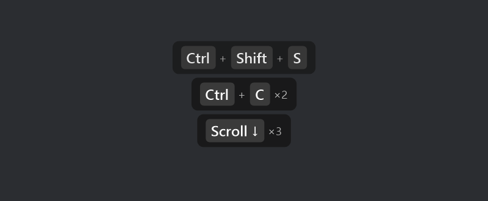

# InputCast

Show **mouse clicks** and **keystrokes** on screen so they show up in your screen recordings.

ShareX has no option to visualize clicks or pressed keys, and it has no plugin system. InputCast is a small
companion tray app that fills the gap: it draws click indicators and a key bubble in transparent,
click-through, always-on-top windows, so ShareX records them like anything else on screen. In the default
**Auto** mode, InputCast detects ShareX's recording and only shows input while a recording is running.

> **Windows only.** InputCast relies on Windows low-level input hooks and layered windows, so it runs on
> Windows 10/11 only — same as ShareX itself.



| Button held | Released (ripple) |
|---|---|
|  |  |

## Features

- **Click indicators**: a coloured circle follows the cursor while a button is held (so drags are visible),
  then a ripple when it is released. Each button has its own colour and an `L` / `R` / `M` / `X1` / `X2` label.
- **Key bubble**: shortcuts as key caps (`Ctrl` + `Shift` + `S`), repeated presses collapsed (`×3`),
  typed text grouped into words, scroll wheel (`Scroll ↓ ×4`), and modifier+click (`Ctrl` + `Left Click`).
- **Your keyboard layout**: punctuation and AltGr characters come from the active layout (e.g. Italian `ò`, `@`).
- **Auto mode for ShareX**: turns on only while ShareX is recording and places the bubble *inside the
  recorded region*, so it is never cut off.
- **Place it anywhere**: four presets (bottom center / left / right, top center) or a **custom position** you
  set by dragging a ghost of the bubble where you want it. Combined with **Always on**, this makes InputCast
  usable with any recorder (OBS, Xbox Game Bar, Teams, Camtasia, …), not just ShareX.
- **Pause hotkey** (`Ctrl+Alt+Shift+K` by default) to hide everything, e.g. while typing a password.
- Per-monitor DPI aware and multi-monitor aware.
- **Privacy**: input is only shown on screen, never logged or sent anywhere. Outside of a recording (in Auto
  mode) the keyboard and mouse hooks are not even installed.

## Install

1. Download `InputCast-win-x64.zip` from [Releases](https://github.com/sim186/InputCast/releases) and extract it
   anywhere. It is a single self-contained `.exe`, so you don't need to install .NET.
2. Run `InputCast.exe`. A keyboard icon appears in the tray.
3. Optional: right-click the tray icon, then **Start with Windows**.

Then record with ShareX as usual.

> **Heads-up on antivirus / SmartScreen.** The released `.exe` is **unsigned** — the GitHub build is produced
> from source with no code-signing certificate. It is also a self-contained single-file app that installs
> global keyboard and mouse hooks to read input, which is exactly the behaviour heuristic antivirus engines
> treat as suspicious. So Windows SmartScreen or your antivirus may warn on first run, or even quarantine the
> file. It is open-source and safe — you can review the code or [build it yourself](#build). To run the
> download, choose *More info → Run anyway* on the SmartScreen prompt; if your antivirus removes it, restore
> it and add an exclusion.

### Tray icon

| Dot | Meaning |
|---|---|
| grey | waiting for a ShareX recording |
| red | active, showing input |
| yellow | paused |

Left-click the icon to pause or resume. Right-click it for the options:

- **Activation**: *Auto* (only while ShareX records), *Always on*, or *Off*. Use *Always on* for other
  recorders (OBS, Xbox Game Bar, Teams, ...).
- Show mouse clicks / keys / typed text / scroll wheel. Turn off *typed text* for shortcuts only.
- Key bubble position: bottom center / left / right, top center, or **Custom – drag to place…** (drag the
  ghost bubble anywhere, then click to lock it in; Esc cancels).
- **Show demo** plays a short sample of every effect.

## Settings

Everything is in `%APPDATA%\InputCast\settings.json` (tray menu: *Edit settings file…*, then *Reload settings*).

| Setting | Default | |
|---|---|---|
| `Mode` | `Auto` | `Auto`, `Always`, `Off` |
| `ShowClicks`, `ShowKeys`, `ShowTyping`, `ShowScroll` | `true` | |
| `ShowLoneModifiers` | `true` | show e.g. a lone `Win` press |
| `ShowClicksInBubble` | `false` | list every click in the bubble (modifier+click is always listed) |
| `ShowClickLabel` | `true` | `L` / `R` / `M` badge next to the click indicator |
| `ClickRadius` | `26` | in DIPs (scaled per monitor) |
| `RippleDurationMs` | `450` | |
| `LeftColor`, `RightColor`, `MiddleColor`, `XButtonColor` | amber, red, blue, purple | `#RRGGBB` or `#AARRGGBB` |
| `BubblePosition` | `BottomCenter` | `BottomCenter`, `BottomLeft`, `BottomRight`, `TopCenter`, `Custom` |
| `CustomX`, `CustomY` | `100` | top-left of the bubble in screen pixels when `BubblePosition` is `Custom`; set via *Custom – drag to place…* |
| `FontSize` | `18` | points |
| `MaxLines` | `3` | lines kept in the bubble |
| `LingerMs` / `FadeMs` | `2000` / `350` | how long a line stays and how long it fades |
| `BubbleBackground`, `BubbleForeground`, `KeyCapBackground` | dark theme | `#AARRGGBB` |
| `FollowRecordingRegion` | `true` | keep the bubble inside ShareX's recording region |
| `PauseHotkey` | `Ctrl+Alt+Shift+K` | any `Ctrl`/`Alt`/`Shift`/`Win` + key name |
| `RecorderTitlePrefixes` | `["ShareX - "]` | window title prefixes of the recorder toolbar |
| `RecorderProcessNames` | `["ShareX"]` | processes whose recording toolbar enables Auto mode |

## How ShareX detection works

While recording, ShareX (v19+) shows a topmost tool window around the recorded region with the title
`ShareX - Screen recording` (localized, e.g. `ShareX - Registrazione schermo`). InputCast polls for a visible
topmost tool window owned by `ShareX.exe` whose title starts with `ShareX - `. It derives the recorded region
from that window: a 1 px border, the region, a 3 px gap, then a 42 DIP toolbar. Older ShareX versions that
record through `ffmpeg.exe` are detected by that process instead, without a region.

If a future ShareX release changes this, adjust `RecorderTitlePrefixes`, or use *Always on* and the pause
hotkey.

## Build

Requires the .NET 10 SDK on Windows.

```powershell
dotnet build -c Release
# self-contained single file:
dotnet publish src/InputCast -c Release -r win-x64 --self-contained -p:PublishSingleFile=true
```

`InputCast.exe --demo` starts the app and immediately plays the demo.

## License

MIT
